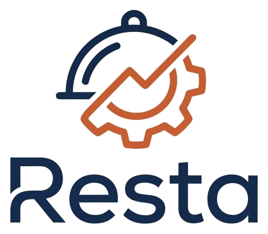
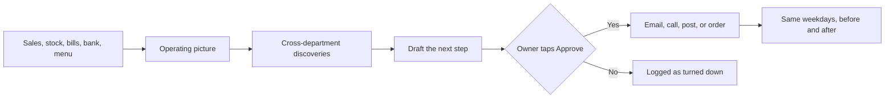

<p align="center">
  
</p>

<h1 align="center">Resta</h1>

<p align="center">
  <strong>The back office for a small restaurant.</strong><br />
  One assistant sees the whole house, finds what is costing money, drafts the fix,<br />
  and does nothing that spends money or contacts someone until the owner taps Approve.
</p>

<p align="center">
  <a href="https://resta-calhacks.vercel.app"></a>
  
  
  
  
  
  
  
</p>

<p align="center">
  <a href="https://resta-calhacks.vercel.app"><strong>Open the demo</strong></a>
  &nbsp;&nbsp;·&nbsp;&nbsp;
  <a href="#what-it-does">What it does</a>
  &nbsp;&nbsp;·&nbsp;&nbsp;
  <a href="#how-it-works">How it works</a>
  &nbsp;&nbsp;·&nbsp;&nbsp;
  <a href="#stack">Stack</a>
  &nbsp;&nbsp;·&nbsp;&nbsp;
  <a href="calhacks/README.md">Run it locally</a>
  &nbsp;&nbsp;·&nbsp;&nbsp;
  <a href="calhacks/docs/DEMO.md">3-minute demo</a>
</p>

---

Built at [Cal Hacks 13.0](https://calhacks.io). The demo is **Pho Berkeley**, a fictional Vietnamese restaurant with a few months of orders, invoices, and payouts. The [live site](https://resta-calhacks.vercel.app) is open for judging: no login.

The goal is to give owners and cooks their time back for the cooking.

## What it does

<table>
  <tr>
    <td width="33%" valign="top">
      <h3>See the whole house</h3>
      Sales, inventory, purchasing, finance, marketing, and the menu in one operating picture. A finding only appears when the data supports every part of it, and every dollar figure shows where it came from.
    </td>
    <td width="33%" valign="top">
      <h3>Draft, then wait</h3>
      Resta writes the dispute, the order, the post, or the supplier call. Sending, paying, publishing, and dialing stay on the Actions board until the owner taps Approve.
    </td>
    <td width="33%" valign="top">
      <h3>Measure afterwards</h3>
      A daily loop opens a case, proposes a fix, and after an approved action runs, compares the same weekdays before and after. The result is reported as association, not proof.
    </td>
  </tr>
</table>

| Page | What the owner gets |
| --- | --- |
| **Overview** | Today's to-do list from every page, ranked by urgency and how much money each item is worth. |
| **Intelligence** | Findings that join two or more departments (a billing error on a bill that is not paid yet, a supplier price rise cutting into several dishes). Each one is marked verified or a hypothesis, with the formula behind every dollar. |
| **Chat** | Ask about anything in the restaurant by typing or holding the mic. Claude answers from the restaurant's own data and can record stock counts, with Undo. |
| **Actions** | Every proposed action in one place: orders, price changes, supplier calls, disputes, posts, emails. A history of everything decided is kept. |
| **Inventory** | Stock against par, low and out items, and the history of every stock change. Scan or email a supplier invoice and its delivery is added to stock. |
| **Prep** | How many plates to prep, forecast from the same weekdays in past sales and adjusted for notes like "Cal home game Saturday". Catering requests that arrive by email wait here to be accepted. |
| **Menu and pricing** | Dish costs from recipes and current supplier prices, margin per plate, and suggested price changes for the menu and the delivery apps. |
| **Invoices and buying** | Every supplier bill checked line by line against the order and past prices: math errors, missing items, price increases. Drafted dispute emails and suggested orders. |
| **Suppliers** | Contacts and price history. With approval, a voice agent calls a supplier to dispute a charge or ask about a price, then reports back with a transcript. |
| **Trends** | Dishes that are popular nearby, from Yelp, Instagram, and TikTok, compared against the menu. |
| **Marketing** | Instagram post drafts with a photo of the dish, written for the restaurant, published after approval. |
| **Accounting** | The restaurant's bank account (Capital One Nessie): delivery payouts checked against the orders they should cover, short or missing payouts caught, and a drafted claim email to DoorDash or Uber Eats. QuickBooks export. |
| **Analytics** | Sales, busy hours, channels, costs, menu performance, and suppliers, with an AI summary and period comparisons. |

## How it works



Intelligence is that picture, computed from the database. **Investigate with Resta** opens the same assistant, which already has the picture in its prompt. Chat can draft. Actions is the only place an approval runs. In the demo, every supplier call goes to a teammate's phone, never a real supplier.

The 3-minute walkthrough is in [`calhacks/docs/DEMO.md`](calhacks/docs/DEMO.md).

## Stack

| | |
| --- | --- |
| **App** | Next.js 16 (App Router), React 19, TypeScript, Tailwind CSS, Recharts. Hosted on Vercel. |
| **AI** | Claude, through the Anthropic API. Chat and tool use, invoice reading, analytics summaries, drafts, and marketing photos. |
| **Database** | Supabase. Postgres for every table, storage for photos. |
| **Live updates** | Convex tells open screens when something changed, so a stock count on a phone shows up on the laptop without a refresh. |
| **Bank** | Capital One's Nessie API for the account, deposits, and transfers. |
| **Phone** | Wajo's calling agent. Demo calls are redirected with `DEMO_CALL_OVERRIDE_NUMBER`. |
| **Voice** | Cartesia, speech to text and text to speech in Chat. |
| **Email** | A Google Apps Script in the restaurant's Gmail forwards supplier invoices and catering requests. |
| **Also** | Brave Image Search for dish photos, Apify for Yelp and social trends, Buffer for Instagram. |

## Run it locally

The app is in [`calhacks/`](calhacks). Node 20 or newer.

```bash
cd calhacks
npm install
npm run dev
```

Open http://localhost:3000. Environment variables, the database, and Convex are documented in [`calhacks/README.md`](calhacks/README.md).

| Command | What it does |
| --- | --- |
| `npm run dev` | Development server |
| `npm run dev:phone` | Same server on your network, so a phone on the Wi-Fi can open it |
| `npm test` | Unit tests (Vitest) |
| `npm run build` | Production build |

## Repository

| Path | What's there |
| --- | --- |
| [`calhacks/`](calhacks) | The Next.js app. Setup and environment variables. |
| [`calhacks/app/`](calhacks/app) | Pages, one folder per section, and the API routes. |
| [`calhacks/lib/`](calhacks/lib) | Server logic: inventory, purchasing, bank, marketing, calls, and the agent. |
| [`calhacks/lib/agent/`](calhacks/lib/agent) | The action log and approval gate. An action is proposed, approved, then run once. |
| [`calhacks/supabase/`](calhacks/supabase) | SQL files, applied in order, and a description of every table. |
| [`calhacks/convex/`](calhacks/convex) | Live-update functions. |
| [`calhacks/integrations/gmail/`](calhacks/integrations/gmail) | The Gmail script. |
| [`calhacks/docs/DEMO.md`](calhacks/docs/DEMO.md) | The 3-minute demo script. |
| [`supabase/snapshot/`](supabase/snapshot) | Exports of the demo database's structure. |
| [`assets/resta-logo.png`](assets/resta-logo.png) | The logo. |

## Team

<p align="center">
  Ethan Yan &nbsp;&nbsp;·&nbsp;&nbsp; William Lin &nbsp;&nbsp;·&nbsp;&nbsp; Aaron Lin
</p>
